<h1 align="center">Daylock</h1>
<p align="center"><b>Daytime Midtown and Hideout for Deadlock</b></p>

<p align="center">
  <a href="https://notmurph.github.io/daylock/"><b>⬇ Install with Deadlock Mod Manager</b></a>
  &nbsp;·&nbsp;
  <a href="https://github.com/NotMurPh/daylock/releases/latest">Manual download</a>
</p>

## Overview

Every MOBA is set at night time and well I got tired, day just looks way better.
Daylock turns Deadlock's Midtown and Hideout into a sunny afternoon.

## Video

[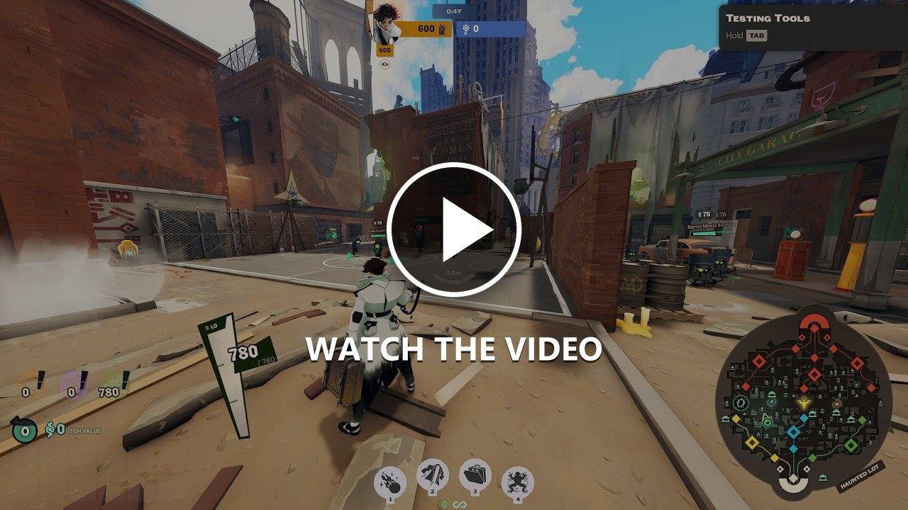](https://youtu.be/34hZJOcqCVo)

▶ [Watch on YouTube](https://youtu.be/34hZJOcqCVo)

## Features

- **Real sunlight:** buildings and props cast real shadows, and sun comes in through windows
- **~7% more FPS:** the night storm and smog effects are gone, so there's less to render
- **Not an unfair advantage:** walls, cover (vent steam, plaza fog), items and spawns are untouched
- **Blue sky** with clouds instead of the night sky
- **Night lights toned down:** lamps and neon don't glow like it's midnight, abilities look the same
- **Also includes the Hideout,** practice hall too
- **One-click install and updates** through Deadlock Mod Manager

## Screenshots

| | |
|---|---|
| <br>Hideout | <br>Hideout practice hall |
| <br>Midtown rooftops | 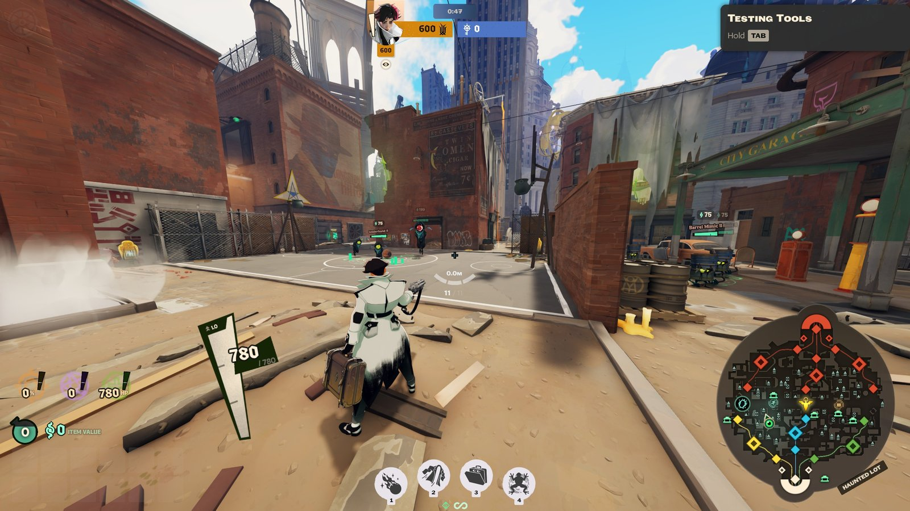<br>City garage lot |
| 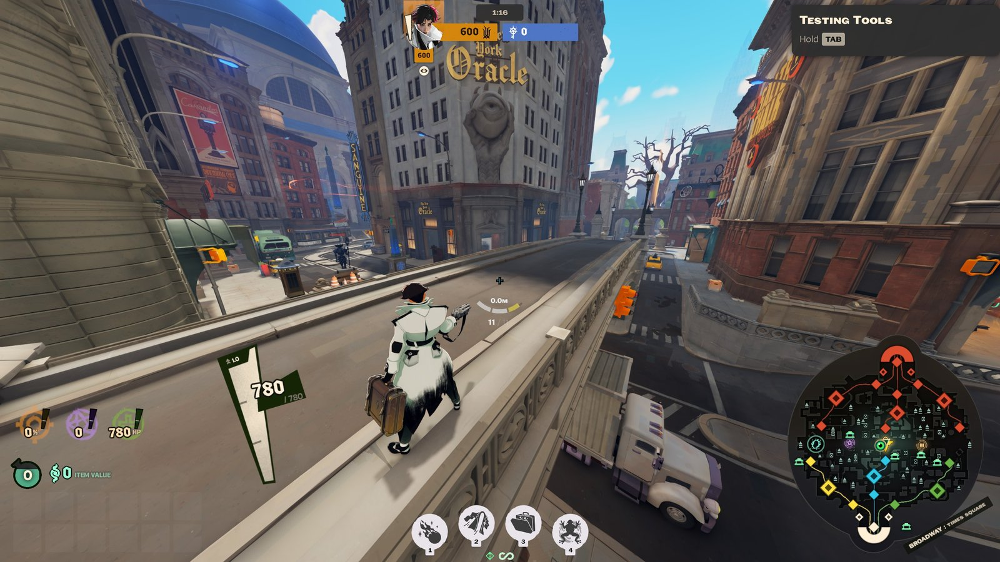<br>Oracle bridge | 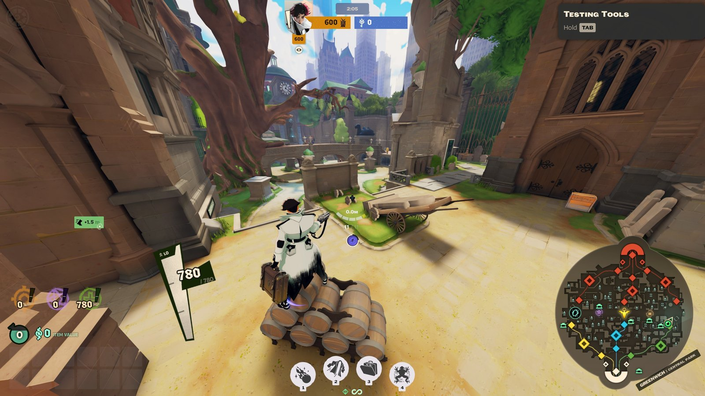<br>The park |
| 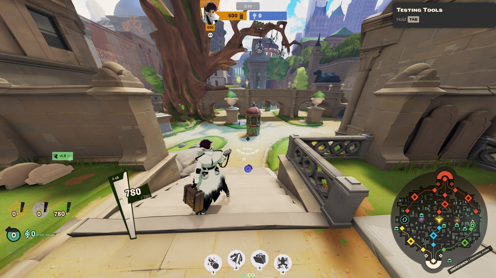<br>Park steps | 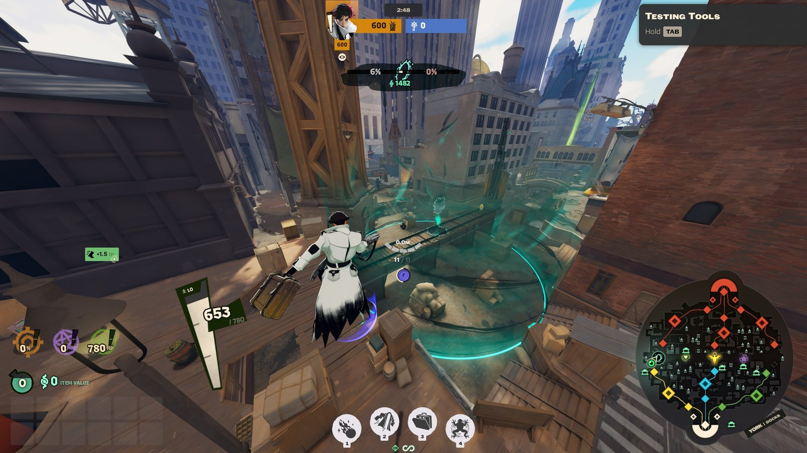<br>In a fight |
| <br>The plaza | <br>Chinatown |

## Old Deadlock Vibes (optional, pre-release)

A second look for everyone who misses the old (pre-3-lane) map's late-afternoon lighting, as asked for in
[issue #1](https://github.com/NotMurPh/daylock/issues/1). It's its own mod, so you pick one: normal Daylock or Old Deadlock Vibes.

- **Low sun in a clear sky:** a big sun near the horizon, no clouds, no haze
- **Warm sunlit walls, cool blue-grey shade** like the old map
- **Crisp ray-traced shadows** with long sun patches down the streets
- **Midtown and the Hideout,** same rules as Daylock: walls, cover, items and spawns are untouched

| | |
|---|---|
| 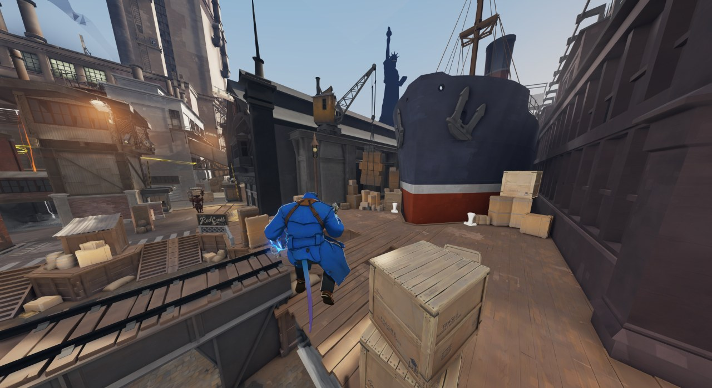<br>Docks | 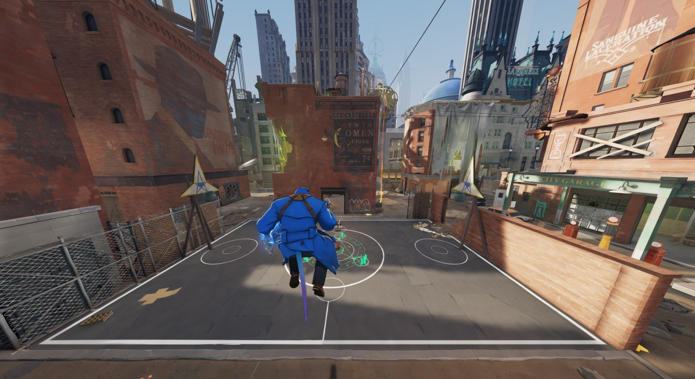<br>Basketball court |
| 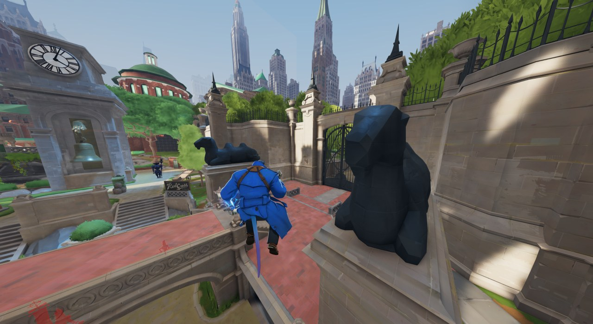<br>The park | 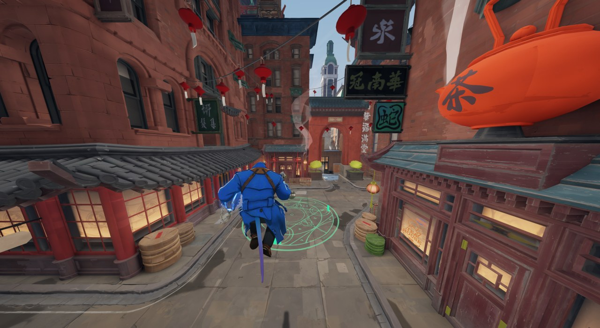<br>Chinatown |
| 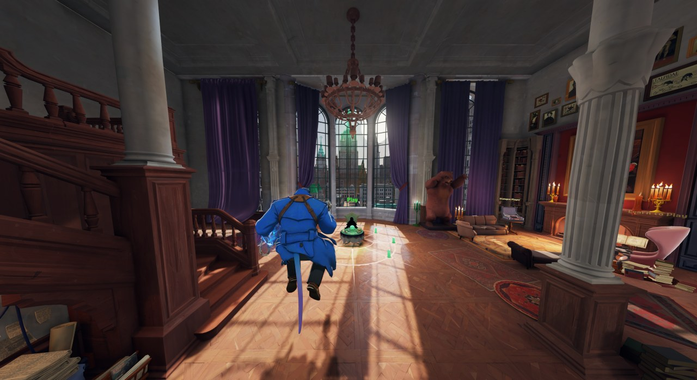<br>Hideout | 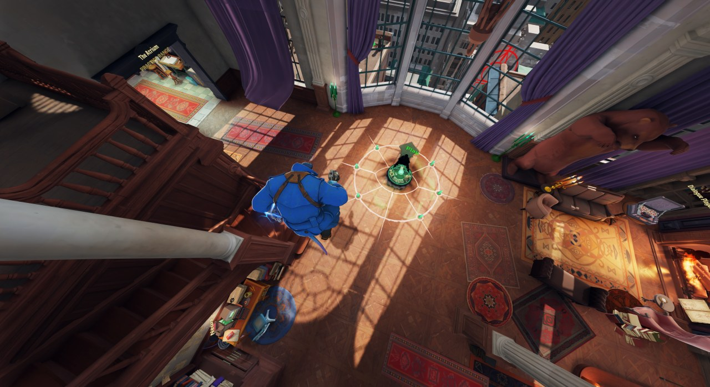<br>Hideout, sun through the windows |

**It's a pre-release for testing:** [download it here](https://github.com/NotMurPh/daylock/releases/tag/v1.2-pre1) (312 MB).

**Why there's an installer:** the finished mod is ~1.6 GB because it has to carry full copies of the maps, but ~1 GB
of that is exactly what's already in your Deadlock folder. So the download only has the parts that are different,
and the included installer rebuilds the full mod from your own map files (it only reads them). Extract the zip,
double-click `Install Daylock Old Deadlock Vibes.bat`, then add the zip it makes in Deadlock Mod Manager
(Mods Library > Add mods > Add Local Mod) or copy its `pak99_dir.vpk` into `Deadlock\game\citadel\addons\`.
Turn the normal Daylock off first, only one can be on.

## Install

**Deadlock Mod Manager** ([Nightly build](https://github.com/deadlock-mod-manager/deadlock-mod-manager/releases/tag/nightly) needed for now, the regular 2.3.0 release doesn't have
custom mod sources yet): open the [install page](https://notmurph.github.io/daylock/) and click **Install with Mod Manager**. Or add this source
under Settings > Mods > Mod sources:

```
https://notmurph.github.io/daylock/dmm-source.json
```

**Manual:** download the zip from [Releases](https://github.com/NotMurPh/daylock/releases/latest)
and put `pak99_dir.vpk` in `Deadlock\game\citadel\addons\` (rename it if you already have a pak99).

## Game updates

If an update doesn't change the maps, Daylock keeps working. If it does, turn it off and wait for me to update it.

## Source code

The code that builds Daylock is in [source](source/), MIT licensed: the build, the test tools and the packaging.
It makes the day maps from your own Deadlock install, so there are no game files in it. How to build, test and
package it is in [source/README.md](source/README.md).

## Credits

Made by Murphy, built with [Claude](https://claude.com/claude-code).
