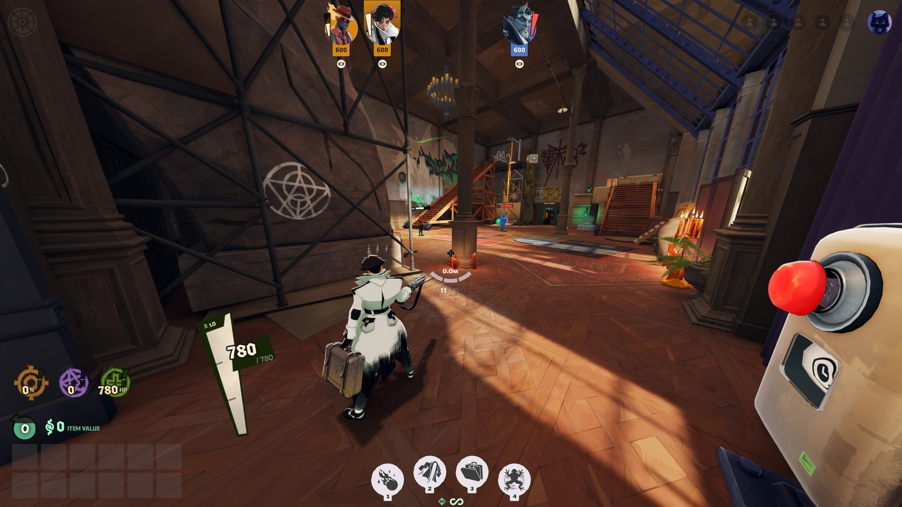
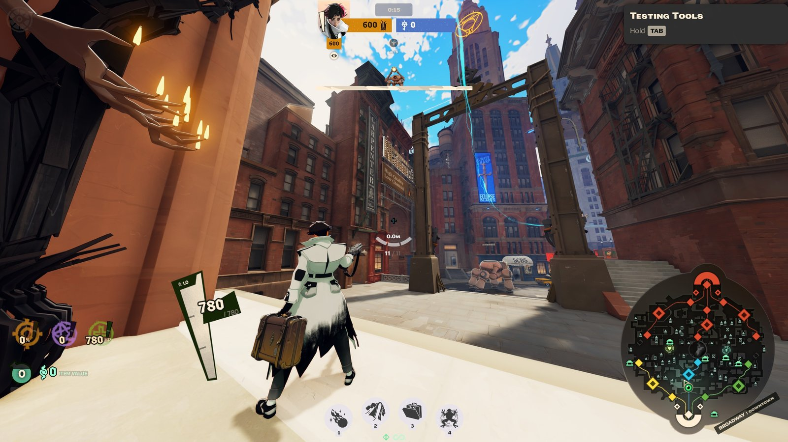
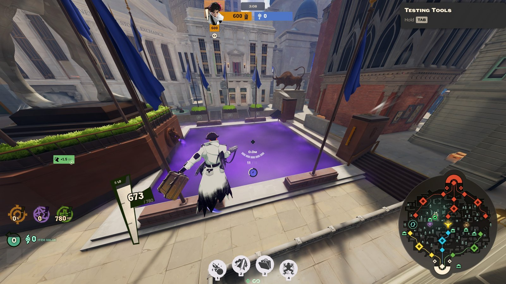
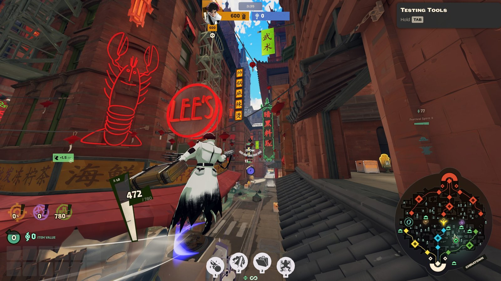

<h1 align="center">Daylock</h1>
<p align="center"><b>Daytime Midtown and Hideout for Deadlock</b></p>

<p align="center">
  <a href="https://notmurph.github.io/daylock/"><b>⬇ Install with Deadlock Mod Manager</b></a>
  &nbsp;·&nbsp;
  <a href="https://github.com/NotMurPh/daylock/releases/latest">Manual download</a>
</p>

## Overview

Every MOBA is set at night time and well I got tired, day just looks way better.
Daylock turns Deadlock's Midtown and Hideout into a sunny afternoon.

## Video

[](https://youtu.be/34hZJOcqCVo)

▶ [Watch on YouTube](https://youtu.be/34hZJOcqCVo)

## Features

- **Real sunlight:** buildings and props cast real shadows, and sun comes in through windows
- **~7% more FPS:** the night storm and smog effects are gone, so there's less to render
- **Not an unfair advantage:** walls, cover (vent steam, plaza fog), items and spawns are untouched
- **Blue sky** with clouds instead of the night sky
- **Night lights toned down:** lamps and neon don't glow like it's midnight, abilities look the same
- **Also includes the Hideout,** practice hall too
- **One-click install and updates** through Deadlock Mod Manager

## Screenshots

| | |
|---|---|
| <br>Hideout | <br>Hideout practice hall |
| <br>Midtown rooftops | <br>City garage lot |
| <br>Oracle bridge | <br>The park |
| <br>Park steps | <br>In a fight |
| <br>The plaza | <br>Chinatown |

## Install

**Deadlock Mod Manager:** open the [install page](https://notmurph.github.io/daylock/) and click
**Install with Mod Manager**. Or add this source under Settings > Mods > Mod sources:

```
https://notmurph.github.io/daylock/dmm-source.json
```

**Manual:** download the zip from [Releases](https://github.com/NotMurPh/daylock/releases/latest)
and put `pak99_dir.vpk` in `Deadlock\game\citadel\addons\` (rename it if you already have a pak99).

## Game updates

If an update doesn't change the maps, Daylock keeps working. If it does, turn it off and wait for me to update it.

## Source code

The code that builds Daylock is in [source](source/), MIT licensed. It makes the day maps from your own Deadlock
install, so there are no game files in it. Build steps are in [source/README.md](source/README.md).

## Credits

Made by Murphy, built with [Claude](https://claude.com/claude-code).
