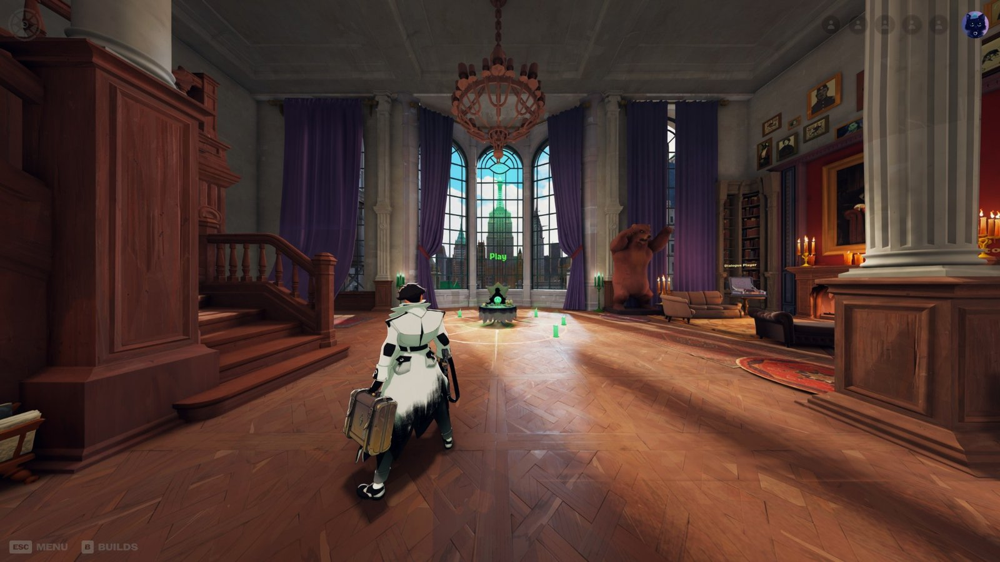
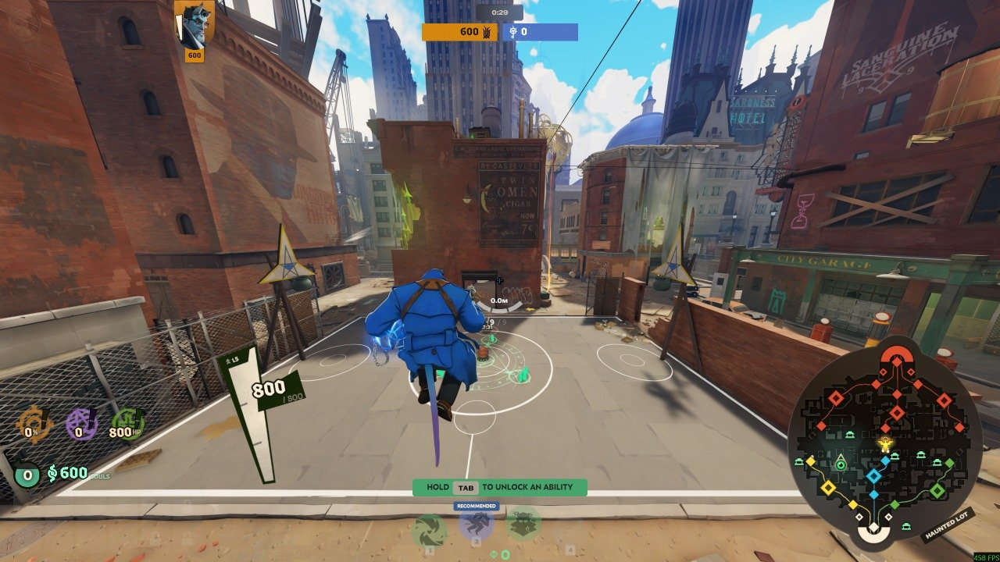
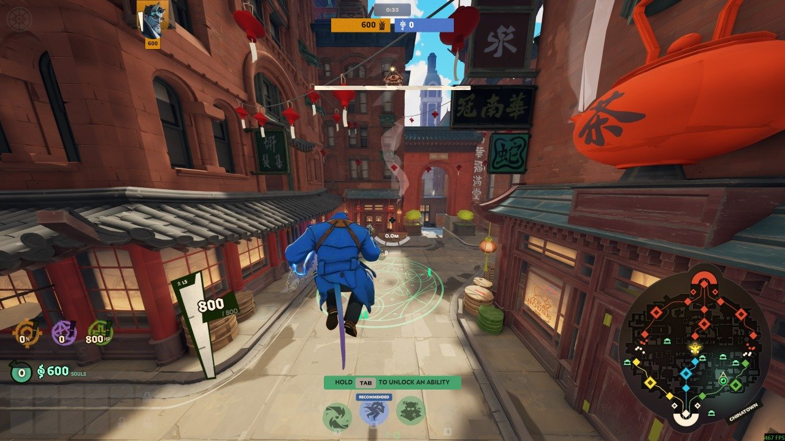

# Daylock

Daytime Midtown and Hideout for Deadlock.



Deadlock is always at night, so I made it day. Daylock turns Midtown and the Hideout into a sunny
afternoon: the sun is baked into the map lighting, so buildings, bridges and props cast real shadows
and light comes in through the windows. The sky is blue with clouds, and the street lamps, neon and
lit windows are turned down so they don't glow in broad daylight.

It only changes how the maps look. Walls, cover (vent steam, the sunken plaza fog), items and spawns
are exactly the same as the normal map, so nobody gets an advantage from it.

It also runs a little faster: about 7% more FPS than stock in my testing (467 vs 438 average at the
same 11 spots around Midtown), mostly because the night storm and smog are gone.

| | |
|---|---|
|  |  |

## Install

### Deadlock Mod Manager

Open the [Daylock page](https://notmurph.github.io/daylock/) and click **Install with Mod Manager**.

Or add the source by hand: in the Mod Manager go to Settings > Mods > Mod sources > Add source,
paste this URL and add it. Daylock then shows up in the Mods Store.

```
https://notmurph.github.io/daylock/dmm-source.json
```

### Manual

1. Download `Daylock_v1.0.zip` from [Releases](https://github.com/NotMurPh/daylock/releases).
2. Put `pak99_dir.vpk` in `steamapps\common\Deadlock\game\citadel\addons\`.
   If you already have a `pak99_dir.vpk` there, rename this one to any free number (`pak42_dir.vpk` etc).
3. The addons folder has to be enabled in `gameinfo.gi`. Any mod manager does that for you.

To remove it, disable it in the Mod Manager or delete the vpk.

## After Deadlock updates

The mod contains full copies of the Midtown and Hideout maps. If an update changes one of those maps,
turn Daylock off until there's an updated version here. Updates that don't touch the maps are fine.

## Credits

Made by ImMurPh, built with [Claude](https://claude.com/claude-code).
